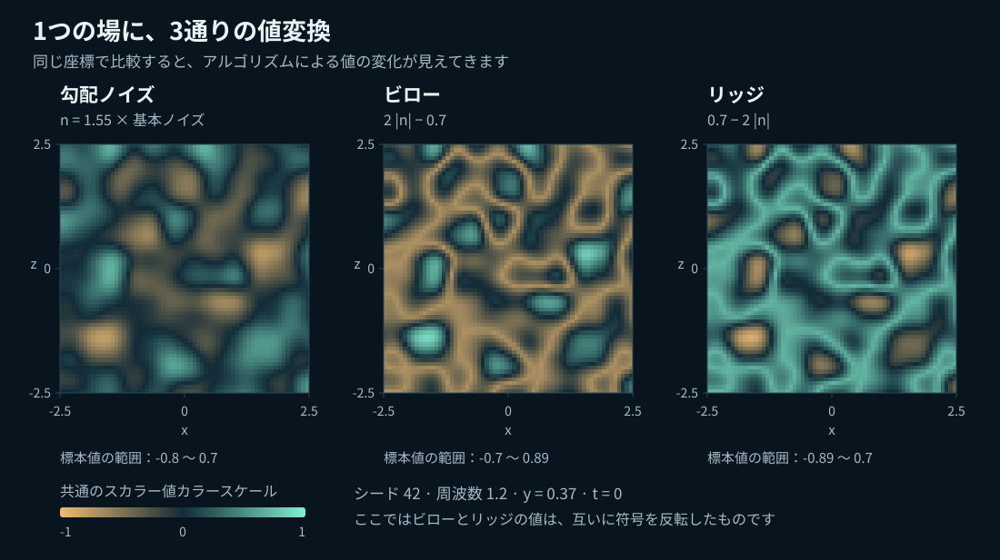
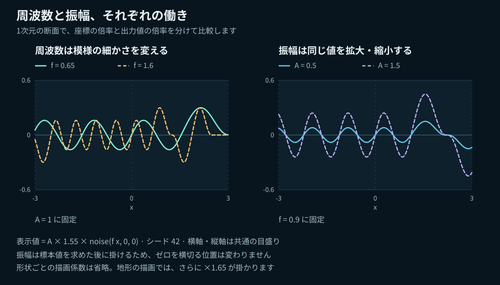
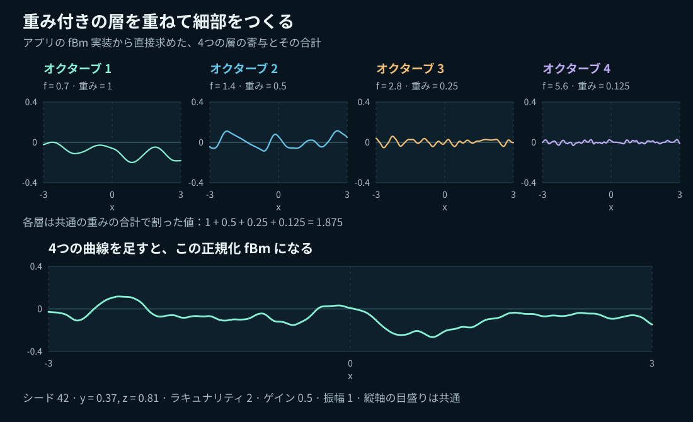
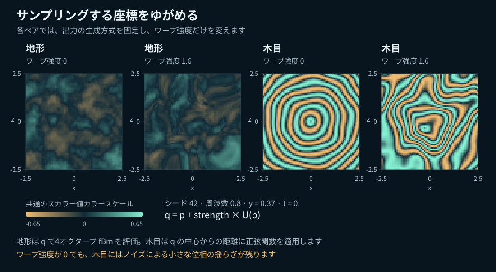
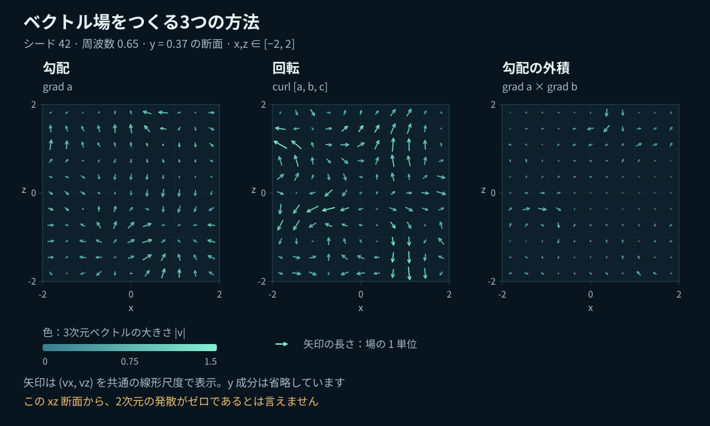

# Noise Field Lab

**3D ノイズ、動く曲面、ベクトルの流れ**を学べる、Three.js 製のインタラクティブな実験室です。スカラー場から地形を作り、異なるスケールを重ね、座標をゆがめてみましょう。空間内や、球面・トーラス面上を進む粒子の動きも観察できます。

**言語：日本語 · [English](README.md)**

アプリの **EN / 日本語** 切り替えでは、現在のパラメーター、時刻、粒子の軌跡はそのまま保たれます。初回はブラウザーの言語に合わせて表示し、明示的に選んだ言語は、ブラウザーの保存機能が利用できる場合に記憶します。

[図解ノイズガイド](docs/NOISE_GUIDE.ja.md) · [クイックスタート](#クイックスタート) · [ノイズを理解する](#ノイズを理解する) · [検証結果](VALIDATION.ja.md)

## 体験できること

- つながりのある 4 つの実験：**Noise → Octaves → Warp → Flow**
- 地形・球・トーラスの表示と、視点の回転、ズーム、等高線、ワイヤーフレーム
- すべての実験で、再生・一時停止、速度変更、時間の移動、リセットが可能
- 球面・トーラス面に沿う矢印と、面上に拘束された粒子の軌跡
- 矢印の密度・長さ、大きさを表す色、粒子の設定を個別に調整
- 再現可能なシード、シミュレーションの処理量制限、動きを減らす設定（reduced motion）への対応

## ノイズを理解する

「ノイズ」は、どれも同じ効果を生むものではありません。この実験室では、**基本となる場**、値の変換、異なるスケールの合成、入力座標の変更、そして場から導くベクトル場を区別して扱います。

| 実験 | 計算するもの | 観察するポイント |
| --- | --- | --- |
| **Noise** | シード付き勾配ノイズ、またはその Billow・Ridged 変換 | なめらかな変化、折り返された丸いふくらみ、鋭い稜線 |
| **Octaves** | 複数の周波数のノイズを重ねた正規化和 | 大きな形に、より細かいディテールが加わる様子 |
| **Warp** | ゆがめた座標で地形ノイズや Wood の輪模様を評価 | 高さだけでなく、模様の位置や形が曲がり、引き伸ばされる様子 |
| **Flow** | 勾配、回転、または 2 つの勾配の外積 | 局所的な向き、速さの違い、時間とともに変わる粒子の軌跡 |

### 1. ひとつの場から生まれる 3 つの形



*シード、周波数、座標、カラースケールは共通です。プロジェクトの関数から計算した数値図であり、スクリーンショットではありません。*

**勾配ノイズ（Gradient noise）**は、3D 空間の位置に対してなめらかに変化する値を返す、再現可能なスカラー関数です。シードで決まる格子上の勾配方向を、5 次のフェード関数で補間します。近くの位置ほど、値にも関連が生まれます。

**Billow** は負の値を上向きに折り返し、折れ目で区切られた丸いふくらみを作ります。**Ridged** はその結果を反転し、元のノイズのゼロ交差を稜線に変えます。いずれも同じ基本場の値を変換するもので、別々の乱数生成器ではありません。

```text
n(p) = 1.55 × baseNoise(frequency × p)
Gradient = n
Billow   = 2 × |n| − 0.7
Ridged   = 0.7 − 2 × |n|
```

この実装では、Ridged は Billow の符号を正確に反転したものです。フィードバックで重みを調整する、より複雑な RidgedMulti アルゴリズムとは異なります。また、絶対値による折り返しによって、微分がなめらかにつながらない点が生じます。

**試してみましょう：** 時刻 0 で一時停止し、シードを 42、周波数を 1.2 に固定して、3 つのアルゴリズムを切り替えてください。[詳しい解説へ →](docs/NOISE_GUIDE.ja.md#勾配ノイズと-billow-と-ridged)

### 2. 周波数は間隔を変え 振幅は変位を変える



*図の値には、形状ごとの描画用倍率を含めていません。地形の描画では、さらに 1.65 倍の係数をかけます。*

- **周波数（Frequency）**は入力座標のスケールを変えます。値を上げるほど模様は小さくなり、間隔が狭くなります
- **振幅（Amplitude）**はサンプリング後の頂点変位を拡大・縮小します。元のスカラー値や、その値を表す色の模様は変えません
- **シード（Seed）**は再現可能な配置を選びます。条件をそろえて比較するときは固定してください

振幅を 0 にすると、地形は平らになり、曲面のメッシュは基本形状に戻ります。ただし、場を表す色の模様は残ることがあります。有限のメッシュでは、細かすぎる模様にエイリアシングが生じます。[形状ごとの倍率と限界へ →](docs/NOISE_GUIDE.ja.md#周波数と振幅)

### 3. オクターブで細部を加える



*各成分は同じ分母で正規化されています。下段の曲線は、それらを足し合わせたものです。*

**Octaves** の実験では、基本ノイズを異なるスケールで重ね、有限のフラクタル・ブラウン運動（fBm）を構成します。

```text
frequency of layer i = frequency × lacunarity^i
weight of layer i    = gain^i
fBm(p) = sum(weight_i × baseNoise(frequency_i × p)) / sum(weight_i)
```

**Layers** は項の数です。**Lacunarity** は次の項の周波数にかける倍率、**Gain** は次の項の重みにかける倍率です。Gain が 0 のときは、最初の層だけが寄与します。重みの正規化によって振幅のスケールを比較しやすくしていますが、分散やピークの高さが一定になるわけではありません。この計算では、Noise の実験で使う 1.55 倍の係数をかけず、基本ノイズをそのまま使います。

**試してみましょう：** 1 層から始めて 5 層まで増やし、Lacunarity を 2 に固定したまま Gain を上げてください。[オクターブの合成を詳しく見る →](docs/NOISE_GUIDE.ja.md#オクターブを重ねる)

### 4. ドメインワープでサンプリング座標を曲げる



*ワープ強度が 0 の Wood にも、ノイズによる小さな木目の変調が含まれます。*

ドメインワープは、`q = p + strength × W(p)` という座標で模様を評価します。`W` の 3 成分には、シード付きノイズの各チャンネルを使います。高さを単に拡大・縮小するのではなく、最終的な関数を**どこで**サンプリングするかを変えます。

- **Warped terrain** は、ゆがめた座標で固定の 4 層 fBm をサンプリングします
- **Wood** は、y 軸からの距離をもとにした正弦波に小さなノイズの位相変調を加え、同じ座標ワープで曲げます

Wood は木目を表現するための模様であり、生物学的な成長モデルではありません。ワープを強くすると座標が折り重なり、解像度では捉えきれない細部が生じることがあります。[正確な式を見る →](docs/NOISE_GUIDE.ja.md#ドメインワープと-wood)

### 5. Flow でスカラー値の変化を方向へ変える



*矢印で示すのは 3D ベクトルの x 成分と z 成分だけです。色には 3 成分すべてが含まれます。この平面図は、2 次元で発散がゼロであることを示すものではありません。*

| 場 | 構成 | 直感的な捉え方 |
| --- | --- | --- |
| **Gradient** | `v = ∇a` | ひとつのスカラーポテンシャルが、局所的に最も急増する方向を向く |
| **Curl** | `v = ∇ × A` | 3 成分のポテンシャルから、回転する構造を作る |
| **Gradient cross** | `v = ∇a × ∇b` | 両方の勾配に垂直。静的な解析的な場では、2 つの等値面の交線に沿う |

粒子は、時間とともに変化する補間された場に従って動きます。軌跡は**流跡線（pathline）**であり、ある瞬間の完全な流線ではありません。十分なめらかなポテンシャルから解析的に構成した Curl と Gradient cross は発散ゼロですが、補間、一定速度への正規化、曲面への射影によって結果は変わります。

球面・トーラス面では、法線成分を取り除きます。

```text
v_tangent = v − normal × dot(normal, v)
```

積分の各ステップで、中点と終点の両方を解析的な曲面上へ戻します。座標には直交座標を使い、角度の継ぎ目や極での座標の問題を避けています。**接平面に射影した Curl が、曲面上でも発散ゼロになるとは限りません。** [図解 Flow ガイドへ →](docs/NOISE_GUIDE.ja.md#値からベクトル場へ)

## クイックスタート

Node.js **20.19 以上または 22.12 以上**、npm、**WebGL 2** 対応ブラウザーが必要です。

```sh
npm ci
npm run dev
```

Vite が表示する URL を開いてください。ローカル実行にバックエンド、API キー、有料サービス、アプリのアカウントは必要ありません。

```sh
npm run check         # lint、数値・幾何・ドキュメントのテスト、本番ビルド
npm run build         # dist/ に静的な本番用ファイルを出力
npm run preview       # 本番ビルドを配信
npm run docs:figures   # サンプリング図と全7点の日本語ラベルを再生成
```

[ソースリポジトリ](https://github.com/domizo/noise-field-lab)は非公開のため、閲覧にはリポジトリへのアクセス権が必要です。ガイドの文章と画像はすべてリポジトリに含まれています。[完全版 Markdown ガイド](docs/NOISE_GUIDE.ja.md)は GitHub 上でそのまま読めます。[HTML 版](public/docs/ja/index.html)をローカルで開くこともできます。どちらも、ホストされた非公開 Site へのアクセスには依存しません。

## 主な操作

| 操作 | 役割 |
| --- | --- |
| ドラッグ / スクロール | 視点の回転とズーム。タッチ操作にも対応 |
| 矢印キー / `+` / `-` / `Home` | ビューポートにフォーカスがあるときのキーボードによるカメラ操作 |
| Play / Pause | 場と、対象となるシミュレーションの再生・一時停止 |
| Playback speed | シミュレーション内の時計の進む速さを変更 |
| Flow speed | 場の時間変化の速さを変えずに、粒子の速度を変更 |
| 時間スライダー / Reset time | 場の時刻を選んで一時停止。Flow では、その時刻でシードに基づく粒子の軌跡を最初から開始 |
| Arrow density / length | 表示のサンプリング密度と矢印の大きさを変更。元の場は変化しない |
| Constant-speed particles | ゼロでない速度を正規化。場による輸送の性質が変わる |

アニメーションは、既存の 3D 場を、なめらかに平行移動する座標 `p + d(t)` でサンプリングします。**4D ノイズではありません。** オフセットは 60 秒でゼロに戻り、再生が止まります。始点と終点でスカラー場は一致しますが、一般に粒子の位置は一致しません。[アニメーションの詳しい説明へ →](docs/NOISE_GUIDE.ja.md#時間による変化)

## 詳しいドキュメント

[図解 Markdown ガイド](docs/NOISE_GUIDE.ja.md)には、実装されているすべてのアルゴリズムと変換、パラメーターの意味、正確な式、条件をそろえた比較、曲面上の拘束、アニメーションの動作、実験例、制約をまとめています。7 点すべての図に、キャプションと説明文が付いています。

サンプリング図は、アプリケーションと同じ数学モジュールから生成します。[図の生成記録](public/docs/images/figure-manifest.json)には、シード、定義域、サンプリング設定、ソースのハッシュが記録されています。射影の図は独自に作成した幾何学的な模式図で、シミュレーションのキャプチャとは明確に区別しています。

## 実装と検証

| 場所 | 担当する処理 |
| --- | --- |
| [`src/lib/noise.js`](src/lib/noise.js) | シード付きノイズ、fBm、微分、ベクトル場、RK2 |
| [`src/lib/animation.js`](src/lib/animation.js) | 範囲を制限した座標の平行移動と時間の計算 |
| [`src/lib/surface.js`](src/lib/surface.js) | 曲面の法線、接平面への射影、拘束付き積分 |
| [`src/lib/scene.js`](src/lib/scene.js) | Three.js による描画、操作、矢印、軌跡、リソースの解放 |
| [`src/lib/animated-surface.js`](src/lib/animated-surface.js) | メッシュバッファの再利用と、継ぎ目の頂点を統合したスカラー曲面 |
| [`tests/`](tests/) | 数学的恒等式、決定性、拘束、ドキュメントの検証 |
| [`scripts/generate-doc-figures.mjs`](scripts/generate-doc-figures.mjs) | 再現可能なサンプリング図の生成 |

描画時のピクセル比は最大 2 です。遅れを取り戻すためのシミュレーション処理量を制限し、動的バッファを再利用し、作り直したリソースを解放します。動きを減らす設定（reduced motion）が有効な場合は、一時停止状態で始まります。スカラー形状の更新は最大 30 Hz です。Flow のキャッシュは有限で近似的なものです。このアプリは手続き的なモデルを学ぶためのもので、検証済みの流体ソルバーではありません。

実施した検証と、ブラウザー QA の正確な範囲は [VALIDATION.ja.md](VALIDATION.ja.md)を参照してください。任意の `npm run test:browser` テストには、インストール済みの Playwright Chromium ランタイム、または有効な `CHROME_PATH` が必要です。このテストは `npm run check` には含まれません。

## 参考文献とライセンス

- [Ken Perlin — Improving Noise](https://mrl.cs.nyu.edu/~perlin/paper445.pdf)
- [Physically Based Rendering — Noise](https://www.pbr-book.org/3ed-2018/Texture/Noise)
- [Bridson, Hourihan & Nordenstam — Curl-Noise for Procedural Fluid Flow](https://www.cs.ubc.ca/~rbridson/docs/bridson-siggraph2007-curlnoise.pdf)

本プロジェクトは学習用に独自実装したものであり、libnoise のビット単位で一致する移植ではありません。プロジェクトのソースと独自の図には [MIT ライセンス](LICENSE)を適用します。依存パッケージには、それぞれのライセンスが引き続き適用されます。[THIRD_PARTY_NOTICES.md](THIRD_PARTY_NOTICES.md)を参照してください。
