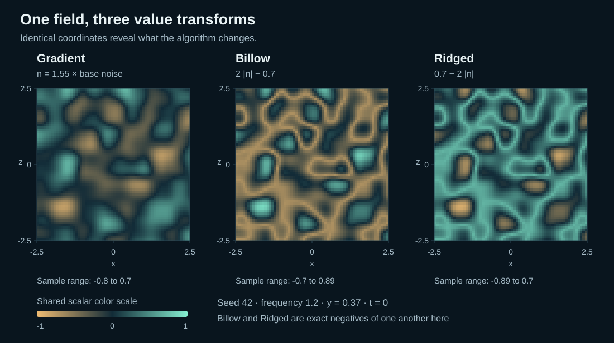
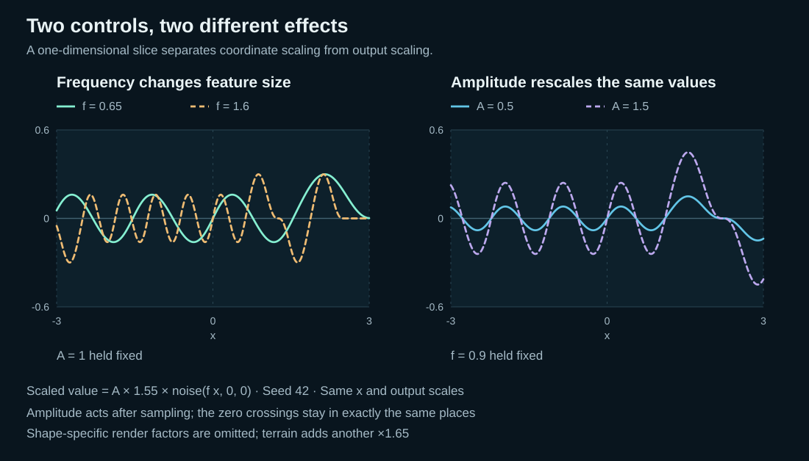
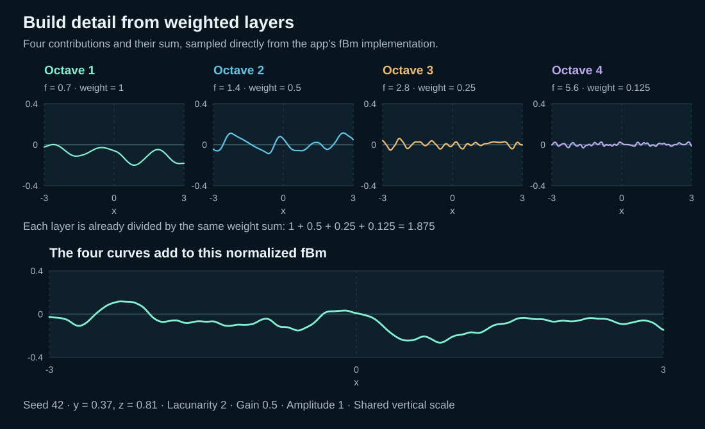
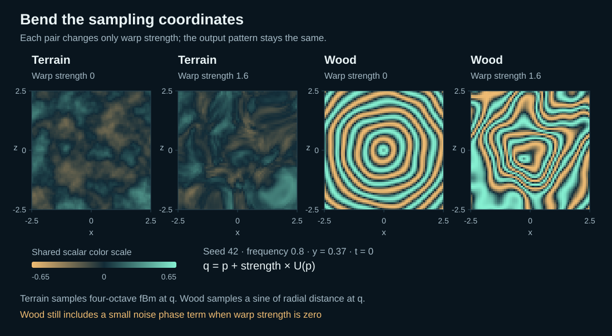
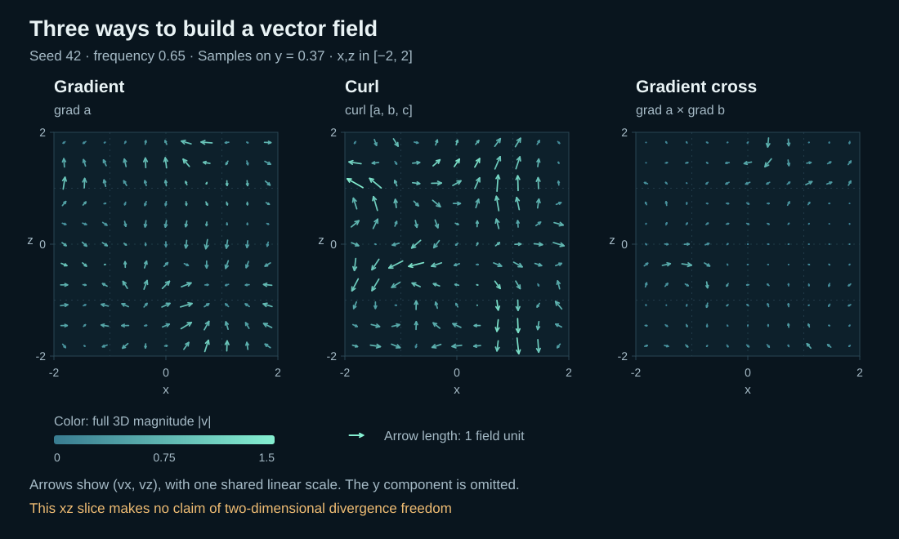

# Noise Field Lab

An interactive Three.js laboratory for **3D noise, animated surfaces and vector flow**. Build a landscape from a scalar field, combine scales, bend coordinates, and follow particles through a volume or along a sphere or torus.

[Illustrated noise guide](docs/NOISE_GUIDE.md) · [Quick start](#quick-start) · [Experiments](#understand-the-noise) · [Validation](VALIDATION.md)

## What you can explore

- Four connected experiments: **Noise → Octaves → Warp → Flow**
- Terrain, sphere and torus views with orbit, zoom, contours and wireframe
- Play/pause, speed, scrubbing and reset in every experiment
- Tangential arrows and constrained particle trails on sphere and torus surfaces
- Independent arrow density, glyph length, magnitude colors and particle controls
- Deterministic seeds, bounded simulation work and reduced-motion support

## Understand the noise

“Noise” is not one interchangeable effect. The experiments separate the **base field**, transformations of its values, combinations of scales, changes to its input coordinates, and vector fields derived from it.

| Experiment | What it computes | What to look for |
| --- | --- | --- |
| **Noise** | Seeded gradient noise, or Billow/Ridged transforms of it | Smooth variation, folded lobes and sharp ridges |
| **Octaves** | A normalized sum of noise at several frequencies | Broad shapes with progressively finer detail |
| **Warp** | Distorted coordinates feeding terrain noise or Wood rings | Features that bend and stretch rather than simply get taller |
| **Flow** | Gradient, curl or the cross product of two gradients | Local directions, speed differences and evolving particle paths |

### 1. One field, three value shapes



*Same seed, frequency, coordinates and color scale. These are numerical plots from the project’s functions, not screenshots.*

**Gradient noise** is a repeatable, smoothly varying scalar function of 3D position. A seeded lattice of gradient directions is blended with a quintic fade. Nearby positions tend to have related values.

**Billow** folds negative values upward, making rounded lobes separated by creases. **Ridged** reverses that folded result, making the zero crossings of the original noise into ridges. These are value transforms of the same base field, not separate random generators.

```text
n(p) = 1.55 × baseNoise(frequency × p)
Gradient = n
Billow   = 2 × |n| − 0.7
Ridged   = 0.7 − 2 × |n|
```

In this implementation, Ridged is exactly the negative of Billow. It is not the more elaborate feedback-weighted RidgedMulti algorithm. The absolute value also introduces derivative corners.

**Try:** pause at time zero, hold seed 42 and frequency 1.2 fixed, then switch between the three algorithms. [Read the full explanation →](docs/NOISE_GUIDE.md#gradient-noise-billow-and-ridged)

### 2. Frequency changes spacing; amplitude changes displacement



*The plotted scaled values omit shape-specific geometry factors. The terrain renderer applies an additional factor of 1.65.*

- **Frequency** scales input coordinates. Higher values make smaller, more closely spaced features
- **Amplitude** scales vertex displacement after sampling. It does not change the underlying scalar values or their color pattern
- **Seed** selects a different repeatable arrangement, so keep it fixed for controlled comparisons

At amplitude zero the terrain becomes flat, or the curved mesh returns to its base shape, but the colored field can still be visible. Very fine detail can alias on a finite mesh. [See geometry scales and limits →](docs/NOISE_GUIDE.md#frequency-and-amplitude)

### 3. Octaves add smaller-scale detail



*Each contribution uses the same normalization denominator; the lower curve is their sum.*

The **Octaves** experiment builds finite fractal Brownian motion (fBm) by adding several scales of the base noise:

```text
frequency of layer i = frequency × lacunarity^i
weight of layer i    = gain^i
fBm(p) = sum(weight_i × baseNoise(frequency_i × p)) / sum(weight_i)
```

**Layers** controls how many terms are used. **Lacunarity** multiplies frequency between terms; **gain** multiplies their weights. At gain zero, only the first layer contributes. Normalizing the weights keeps amplitude scale comparable, but does not fix variance or peak heights. This branch uses raw base noise without the Noise experiment’s 1.55 multiplier.

**Try:** start with one layer, add up to five, then increase gain while keeping lacunarity at 2. [Explore octave composition →](docs/NOISE_GUIDE.md#building-with-octaves)

### 4. Domain warping bends the sampling coordinates



*Zero-strength Wood still contains a small noise-based grain modulation.*

Domain warp evaluates a pattern at `q = p + strength × W(p)`. The three components of `W` are seeded noise channels. This changes **where** the final function is sampled rather than just scaling its height.

- **Warped terrain** samples a fixed four-layer fBm at the distorted coordinates
- **Wood** starts with a sine pattern of distance from the y-axis, adds small noise phase modulation, and bends it with the same coordinate warp

Wood is a stylized material pattern, not a biological growth model. Large warp strength can fold coordinates and create under-resolved detail. [See the exact equations →](docs/NOISE_GUIDE.md#domain-warping-and-wood)

### 5. Flow turns scalar variation into direction



*Arrows show only the x and z components of 3D vectors. Color includes all three components; the flattened picture makes no two-dimensional divergence claim.*

| Field | Construction | Intuition |
| --- | --- | --- |
| **Gradient** | `v = ∇a` | Points toward the steepest local increase of one scalar potential |
| **Curl** | `v = ∇ × A` | Produces rotational structure from a three-component potential |
| **Gradient cross** | `v = ∇a × ∇b` | Is perpendicular to both gradients; in a static analytic field, it follows intersections of their level surfaces |

Particles follow an evolving, interpolated field. Their trails are **pathlines**, not complete instantaneous streamlines. Curl and gradient-cross constructions are analytically divergence-free for sufficiently smooth potentials, but interpolation, constant-speed normalization and surface projection change the result.

On a sphere or torus, the normal component is removed:

```text
v_tangent = v − normal × dot(normal, v)
```

Both the midpoint and endpoint of each integration step are projected back onto the analytic surface. Cartesian coordinates avoid angular seams and pole charts. **A projected tangent curl is not generally surface-divergence-free.** [Read the illustrated flow guide →](docs/NOISE_GUIDE.md#from-values-to-vector-fields)

## Quick start

Requires Node.js **20.19+ or 22.12+**, npm, and a browser with **WebGL 2**.

```sh
npm ci
npm run dev
```

Open the URL printed by Vite. No backend, API key, paid service or application account is needed to run the project locally.

```sh
npm run check         # lint, numerical/geometry/docs tests, production build
npm run build         # static production output in dist/
npm run preview       # serve the production build
npm run docs:figures   # regenerate the six sampled SVG diagrams
```

All guide text and images are included in the repository. Read the [complete Markdown guide](docs/NOISE_GUIDE.md) directly on GitHub, or open [the HTML edition](public/docs/index.html) locally. Neither depends on access to a hosted private Site.

## Controls at a glance

| Control | Purpose |
| --- | --- |
| Drag / scroll | Orbit and zoom; touch gestures are also supported |
| Arrow keys / `+` / `-` / `Home` | Keyboard camera controls when the viewport is focused |
| Play / Pause | Start or stop the field and relevant simulation |
| Playback speed | Change the simulated clock rate |
| Flow speed | Change particle velocity without changing field-time rate |
| Time slider / Reset time | Select field time and pause; Flow restarts seeded paths at that time |
| Arrow density / length | Change display sampling and glyph size, not the underlying field |
| Constant-speed particles | Normalize nonzero velocity; this changes the field’s transport properties |

Animation samples the existing 3D field at a smoothly translated coordinate `p + d(t)`; it is **not 4D noise**. The offset returns to zero at 60 seconds, when playback stops. Scalar fields match at the endpoints, but particle positions generally do not. [Animation details →](docs/NOISE_GUIDE.md#moving-through-time)

## Full documentation

The [illustrated Markdown guide](docs/NOISE_GUIDE.md) includes every implemented algorithm and transform, parameter meanings, exact formulas, controlled comparisons, surface constraints, animation semantics, recipes and limitations. All seven diagrams include captions and descriptive text.

Sampled figures are generated from the same math modules used by the application. [Figure provenance](public/docs/images/figure-manifest.json) records seeds, domains, sampling settings and source hashes. The projection figure is an original geometric schematic, explicitly distinguished from a simulation capture.

## Implementation and validation

| Location | Responsibility |
| --- | --- |
| [`src/lib/noise.js`](src/lib/noise.js) | Seeded noise, fBm, derivatives, vector fields and RK2 |
| [`src/lib/animation.js`](src/lib/animation.js) | Bounded coordinate translation and time arithmetic |
| [`src/lib/surface.js`](src/lib/surface.js) | Surface normals, tangent projection and constrained integration |
| [`src/lib/scene.js`](src/lib/scene.js) | Three.js rendering, controls, arrows, trails and resource cleanup |
| [`src/lib/animated-surface.js`](src/lib/animated-surface.js) | Reused mesh buffers and seam-welded scalar surfaces |
| [`tests/`](tests/) | Numerical identities, determinism, constraints and documentation checks |
| [`scripts/generate-doc-figures.mjs`](scripts/generate-doc-figures.mjs) | Reproducible sampled illustrations |

The renderer caps pixel ratio at 2, limits catch-up simulation work, reuses dynamic buffers, disposes rebuilt resources and starts paused when reduced motion is requested. Scalar geometry updates are capped at 30 Hz. The Flow cache is finite and approximate; the app is an educational procedural model, not a validated fluid solver.

See [VALIDATION.md](VALIDATION.md) for performed checks and exact browser-QA limits. The optional `npm run test:browser` suite requires an installed Playwright Chromium runtime or a valid `CHROME_PATH`; it does not run as part of `npm run check`.

## References and license

- [Ken Perlin — Improving Noise](https://mrl.cs.nyu.edu/~perlin/paper445.pdf)
- [Physically Based Rendering — Noise](https://www.pbr-book.org/3ed-2018/Texture/Noise)
- [Bridson, Hourihan & Nordenstam — Curl-Noise for Procedural Fluid Flow](https://www.cs.ubc.ca/~rbridson/docs/bridson-siggraph2007-curlnoise.pdf)

This is an independent educational implementation, not a bit-exact port of libnoise. Project source and original diagrams use the [MIT license](LICENSE); dependencies retain their own licenses in [THIRD_PARTY_NOTICES.md](THIRD_PARTY_NOTICES.md).
