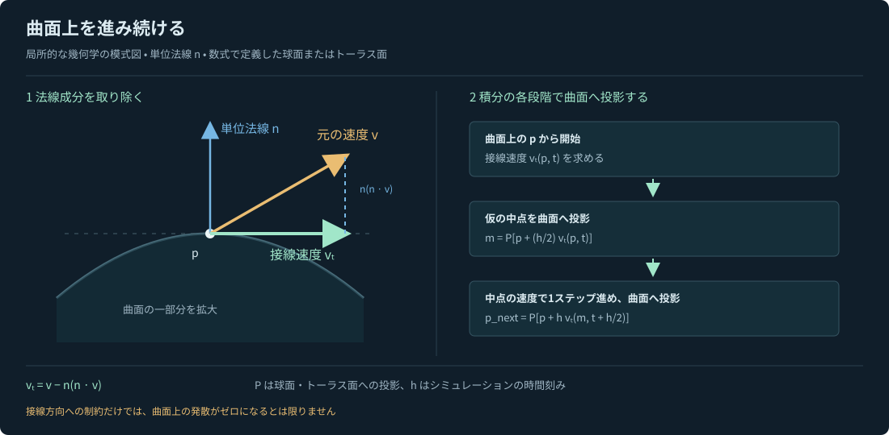
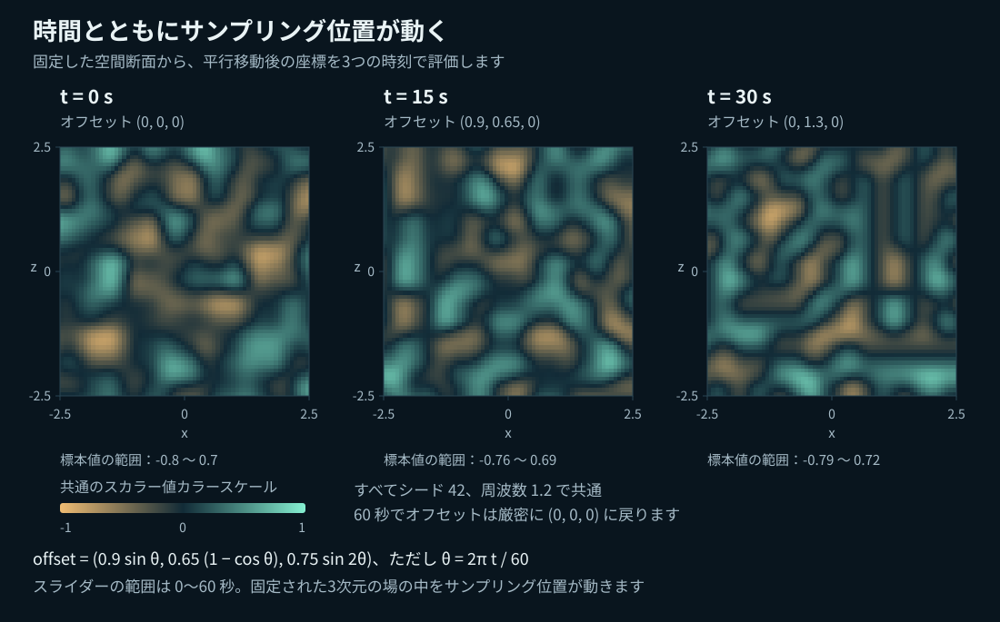

# 図解 Noise Lab ガイド

**言語：日本語 · [English](NOISE_GUIDE.md)**

アプリの **EN / 日本語** 切り替えでは、現在のパラメーター、時刻、粒子の軌跡はそのまま保たれます。初回はブラウザーの言語に合わせて表示し、明示的に選んだ言語は、ブラウザーの保存機能が利用できる場合に記憶します。

[プロジェクトの README とセットアップ](../README.ja.md) · [日本語 HTML 版](../public/docs/ja/index.html)

ひとつのなめらかな関数から、地形も、折り返された模様も、動く流れも生まれます。このガイドでは、Noise Lab の各実験が何を計算し、操作によって何が変わり、どこにモデルの限界があるかを解説します。インタラクティブなアプリを起動しなくても、GitHub 上でそのまま読めます。

掲載している図は、条件をそろえた数値図と独自の説明図であり、スクリーンショットではありません。6 点のサンプリング図にはプロジェクトの数学コードを使い、曲面への射影の図は幾何学的な模式図として作成しています。図を比較するときは、シード、座標、時刻、カラースケールを固定してください。各図にはサンプリング条件を明記しています。

## 目次

1. [実験の全体像](#実験の全体像)
2. [勾配ノイズと Billow と Ridged](#勾配ノイズと-billow-と-ridged)
3. [周波数と振幅](#周波数と振幅)
4. [オクターブを重ねる](#オクターブを重ねる)
5. [ドメインワープと Wood](#ドメインワープと-wood)
6. [値からベクトル場へ](#値からベクトル場へ)
7. [球面とトーラス面上の流れ](#球面とトーラス面上の流れ)
8. [時間による変化](#時間による変化)
9. [操作とパラメーターの実験例](#操作とパラメーターの実験例)
10. [図の再生成とソースコード](#図の再生成とソースコード)
11. [参考文献](#参考文献)

## 実験の全体像

| モジュール | 主な処理 | 観察するポイント |
| --- | --- | --- |
| **Noise** | シード付きの勾配場が各位置でスカラー値を返し、Billow と Ridged がその値の形を変える | なめらかな変化、ゼロ交差での折り返し、稜線 |
| **Octaves** | 同じ基本場を複数のスケールで評価し、重みをかけて足し合わせる | 大きな形に、より細かいディテールが加わる様子 |
| **Warp** | 3 成分のノイズ場でサンプリング座標を変更。Wood では動径方向の周期的な模様も加わる | 模様の位置が移り、引き伸ばされ、曲がる様子 |
| **Flow** | 空間微分によってスカラーまたはベクトルのポテンシャルを、粒子を動かすベクトルに変える | 向き、大きさ、軌跡、曲面上の拘束 |

これらは互いに関係する処理であり、無関係な 4 つの乱数生成器ではありません。Billow と Ridged は同じ基本ノイズの値を変換します。Octaves は異なるスケールを合成し、Warp は座標を変え、Flow はポテンシャルを微分します。

このガイドは、実装済みのアプリを対象にしています。セルラー／Voronoi ノイズ、Simplex ノイズ、libnoise の完全な RidgedMulti アルゴリズム、物理的な流体シミュレーションは含まれません。

以降、`p = (x, y, z)` はサンプリング位置、`N` は倍率をかけていないシード付き基本ノイズ関数、`f` は画面上の周波数設定を表します。スカラーメッシュの振幅は、これらとは別の表示用倍率です。

## 勾配ノイズと Billow と Ridged

空間のあらゆる場所に定義された、何度でも再現できる地形を想像してください。ある点の値を調べ、少し移動してもう一度調べると、値はなめらかに変化します。シードはその配置を選ぶもので、フレームごとに新しい乱数を加えるものではありません。

基本関数は、整数格子の各頂点に勾配方向を割り当てます。セルの内部では、各頂点で求めた内積を、なめらかな 5 次曲線で補間します。この実装は Perlin 方式のシード付き勾配ノイズで、単位長さの 12 種類の勾配と、シードで並べ替えた順列表を使います。**基本ノイズの各座標軸**に沿って、256 単位ごとに繰り返します。


**図 1. 同じサンプルから異なる形の出力を作る。** Billow は負の値を上向きに折り返し、Ridged は折り返した結果を反転します。シードは 42、周波数は 1.2、`y = 0.37`、時刻は 0、`x,z` の範囲は `[-2.5, 2.5]` です。共通のカラースケールによって、変換後の値を直接比較できます。

### Noise モジュールの正確な定義

```text
n(p) = 1.55 N(f p)

Gradient(p) = n(p)
Billow(p)   = 2 |n(p)| − 0.7
Ridged(p)   = 0.7 − 2 |n(p)|
```

- **Gradient** は、なめらかな丘、テクスチャの変化、変位に適しています。正と負の値が連続的に変化します。サンプル値がちょうど −1 から +1 の全範囲にわたる保証はありません。
- **Billow** は、折れ目で区切られた丸いふくらみを強調します。雲や岩を思わせる様式的な形の表現に適しています。絶対値によって、元の場がゼロを横切る場所で微分に折れが生じます。
- **Ridged** は、そのゼロ交差を高い稜線に変えます。様式的な山脈や脈状の模様に適しています。ここでの Ridged は、Billow の符号を正確に反転したものです。複数オクターブの重みをフィードバックで調整する稜線アルゴリズムではありません。

変換名は、このアプリでの出力の形を表しています。独立した別のノイズアルゴリズムが追加実装されていることを意味しません。

**試してみましょう：** Noise で一時停止し、時刻をリセットします。シードを固定したまま、周波数や振幅を変えずに Gradient → Billow → Ridged と切り替えてください。折れ目は、元の場のゼロ交差に対応します。

### 補間はなぜなめらかになるのか

セル内の小数座標 `u` に対するフェード多項式は、次のとおりです。

```text
fade(u) = 6u⁵ − 15u⁴ + 10u³
```

この関数は両端で 1 階微分と 2 階微分がゼロになり、セルの境界をまたぐ補間がなめらかにつながります。12 種類の勾配方向は、`(±1, ±1, 0)` の各成分を並べ替えて `√2` で割ったものです。このプロジェクトは独自のシード付き順列表と倍率を使うため、他の実装とビット単位で一致する複製ではありません。

実装：[`noise.js` の `createNoise` と `createFields`](../src/lib/noise.js)。

## 周波数と振幅

**周波数は模様の大きさを変え、振幅は変位の高さを変えます。** 周波数は、サンプリング前の入力座標にかける倍率です。値を上げると、同じ表示範囲により多くの変化が詰め込まれます。振幅は、スカラー値を計算した後の幾何学的な変位を拡大・縮小するもので、スカラー場の模様自体は変えません。


**図 2. 横方向で間隔を、縦方向で倍率をかけた値を読む。** 両パネルともシードは 42、断面は `y = z = 0` です。左は振幅 1 で周波数 0.65 と 1.6 を、右は周波数 0.9 で振幅 0.5 と 1.5 を比較しています。形状ごとの描画用係数は含めていません。シードを変えると、このような条件をそろえた比較にはなりません。

**色が表すのは場の値であり、変位の距離ではありません。** Amplitude を上げると頂点は動きますが、サンプリングされたスカラー値は変わりません。振幅を 0 にすると地形は平らになり、球やトーラスは基本形状に戻りますが、色の模様は残ることがあります。

### サンプリング位置と表示用の倍率

アニメーションを適用する前に、描画処理は基本形状の座標 `(X, Y, Z)` を次のようにサンプリング座標へ変換します。

| スカラー表示の形状 | アニメーションのオフセットを加える前のサンプリング位置 | 幾何学的な変位 |
| --- | --- | --- |
| 地形 | `(0.65X, 0.371, 0.65Z)` | 高さ = `1.65 × amplitude × value` |
| 球 | `0.65(X, Y, Z)` | 基本曲面の法線方向に `0.50 × amplitude × value` |
| トーラス | `0.65(X, Y, Z)` | 基本曲面の法線方向に `0.25 × amplitude × value` |

選択した場を評価する前に、このサンプリング座標へアニメーションのオフセットを加えます。これらの形状ごとの係数は表示側の設定であり、ノイズアルゴリズムの一部ではありません。図には、それぞれのサンプリング座標を記載しています。図の断面が、描画処理の地形断面と一致する必要はありません。

有限のメッシュでは、細かすぎる模様にエイリアシングが生じます。Fine の描画品質ではサンプル数が増えますが、どれほど高い周波数や細かいオクターブでも解像できるわけではありません。小さい画面では、メッシュ解像度に上限を設けています。

実装：[`animated-surface.js`](../src/lib/animated-surface.js)。

## オクターブを重ねる

大きな丘から始め、より小さな模様を持つ弱い場を加えます。それを繰り返すと、再現性を保ちながら、細部の豊かな地形に近づきます。このアプリの fBm は**勾配ノイズの有限の重み付き和**であり、厳密な確率過程としての分数ブラウン運動ではありません。


**図 3. 表示された各成分を足すと、最終的な場になる。** 各成分は同じ位置で評価し、周波数と重みを変えています。この例は 4 層で、基本周波数 0.7、Lacunarity 2、Gain 0.5 です。各成分を、共通の重みの総和 `1 + 0.5 + 0.25 + 0.125 = 1.875` で割っています。各パネルが別々に正規化されていると考えず、記載された目盛りを比較してください。

### 正規化した重み付き和

```text
                K−1
                Σ  gⁱ N(f λⁱ p)
                i=0
F(p) = ───────────────────────────
                      K−1
                      Σ  gⁱ
                      i=0
```

同じ式を、`F(p) = Σᵢ₌₀ᴷ⁻¹ gⁱ N(f λⁱ p) / Σᵢ₌₀ᴷ⁻¹ gⁱ` とも書けます。

| パラメーター | 意味 | 比較の目安 |
| --- | --- | --- |
| **Layers K** | 足し合わせる項の数 | 1 層なら、周波数 `f` の基本ノイズそのもの |
| **Lacunarity λ** | 層の間で周波数にかける倍率 | 2 なら、層をひとつ進むごとに模様の大きさがおよそ半分になる |
| **Gain g** | 層の間で振幅の重みにかける倍率 | 0.5 なら次の層の強さは半分。0 なら最初の層だけが寄与する |

厳密には、オクターブは周波数が 2 倍になることを指します。このアプリでは、それ以外の倍率も指定できます。各スケールで同じ基本場を再利用しており、層ごとに新しい乱数生成器を用意するわけではありません。

重みの総和で割ることで、全体の振幅スケールを比較しやすくしています。ただし、分散、勾配の大きさ、ピークの高さが一定になる保証は**ありません**。Noise タブとは異なり、Octaves タブでは**基本ノイズ `N` をそのまま使い、Noise の 1.55 倍の係数はかけません**。

**試してみましょう：** Octaves を選び、一時停止して時刻をリセットし、1 層から始めます。Gain 0.5、Lacunarity 2 で 5 層まで増やしてください。次に 5 層に固定し、Gain を 0.8 まで上げます。細かなディテールの影響が強くなります。ワイヤーフレームを使うと、メッシュが細部を解像できなくなる様子を確認できます。

この構成は、複数スケールの地形や材質の変化を作るのに適しています。ただし、有限個の項をフィルターなしで足し合わせた結果が、自然な侵食、スケール不変性、エイリアシングのない描画を保証するわけではありません。

実装：[`noise.js` の `fbm`](../src/lib/noise.js)。

## ドメインワープと Wood

通常の変位は、出力の高さを変えます。ドメインワープは、その出力を調べる位置を変えます。3 成分のノイズ場で先に座標を曲げることで、もともと単純な模様でも、引き伸ばされたり巻き込まれたりします。

```text
q = p + w W(p)

Warped terrain = fBm₄(q; frequency = f, lacunarity = 2, gain = 0.5)
```

ここで `w` は Warp strength、`W` は座標オフセットの場、`q` はゆがめた後のサンプリング位置です。


**図 4. 共通の座標のゆがみから、2 種類の模様を作る。** 各組はワープ強度 0 と 1.6 の比較です。シードは 42、周波数は 0.8、時刻は 0 で、サンプリング範囲も同じです。Terrain と Wood は座標のゆがみを共有しますが、最終的に評価するスカラー関数が異なります。共通のスカラーカラースケールは `[-0.65, 0.65]` です。

Warp strength は、座標のオフセット量を調整します。ワープの各チャンネル自体の周波数は **0.65 に固定**されています。画面上の Frequency が変えるのは最終的な模様の周波数であり、内部のワープ周波数ではありません。地形側の計算は、**常に 4 層**、Lacunarity 2、Gain 0.5 です。Octaves タブの層数は、ここには適用されません。ワープが 0 のとき、地形は対応するワープなしの 4 層 fBm になります。

### ワープの各チャンネルの正確な構成

`N₀` のシードを `s`、`N₁` を `s + 1013`、`N₂` を `s + 2029` とすると、次のようになります。

```text
Wₓ(p) = N₀(0.65p + (17, 0, 0))
Wᵧ(p) = N₁(0.65p + (0, 31, 0))
W_z(p) = N₂(0.65p + (0, 0, 9))
```

オフセットとシードを変えることで異なるチャンネルを作っていますが、統計的な独立性を主張するものではありません。

### Wood は軸からの距離から始まる

y 軸を中心とする動径距離の正弦波から、同心円状の輪模様が生まれます。

```text
r = √(qₓ² + q_z²)

Wood(p) = 0.65 sin[4π(f √(qₓ² + q_z²) + 0.25 N₀(f q))]
```

小さなノイズ項で輪の位相を変調し、座標ワープで輪を曲げます。**ワープが 0 のときも、Wood には小さな木目の変調が残ります。** したがって、ワープを 0 にしても、まったく乱れのない動径方向の正弦波にはなりません。

Wood は木目を表現するための周期的な模様であり、樹木の成長モデルや、スキャンした木材のテクスチャではありません。また、ワープが可逆である保証もありません。強いゆがみは空間を折り重ね、密集して解像しにくいディテールを生むことがあります。

**試してみましょう：** Warp を選び、強度を 0 にします。周波数を固定したまま、強度を上げてください。Wood rings でも同じ操作を行います。一時停止した状態で、地形 → 球 → トーラスと切り替え、同じ 3 次元の模様が異なる形状とどう交わるかを見てください。

実装：[`createFields.scalar` の Warp 分岐](../src/lib/noise.js)。

## 値からベクトル場へ

スカラーはひとつの値を持ちます。ベクトルは 3 つの成分を持ち、それらが向きと大きさを表します。Flow では、なめらかなノイズのポテンシャルからベクトルを作り、粒子の速度として使います。


**図 5. 断面図に見えるのは、3 次元ベクトルのうち 2 成分だけ。** 省略された y 成分も重要です。断面への射影だけでは、2 次元の非圧縮性を証明できません。この図では、キャッシュ補間、一定速度への正規化、曲面への射影を行う前の、アプリの有限差分による場の関数を直接使っています。矢印の成分には共通の線形スケールを使い、色は 3 次元ベクトル全体の大きさを示します。実行中のアプリでは、後述する表示用の倍率と上限が加わります。

### Gradient でスカラーの坂を上る

```text
v = ∇a
```

勾配は、局所的に最も急増する方向を向きます。その大きさは、距離に対して `a` がどれほど速く変化するかを表します。静的な勾配場では、粒子は局所的な極大点へ向かう傾向があります。ポテンシャルを動かすと、その極大点も移動します。勾配場は一般に発散ゼロではありません。

### Curl でポテンシャルから回転を作る

```text
v = ∇ × A
```

3 成分のポテンシャル `A` から、回転する構造を作ります。ポテンシャルが十分になめらかなら、解析的に求めた Curl の発散はゼロです。個々の軌跡が閉じたループになるとは限りません。

### Gradient cross で等値面の交線をたどる

```text
v = ∇a × ∇b
```

このベクトルは、両方のスカラー場の勾配に垂直です。静的な解析的な場では、軌跡は等値面の交線に沿います。勾配が平行な場合や、どちらかがゼロの場合、外積はゼロになります。

なめらかな `a` と `b` から解析的に構成した Gradient cross も発散ゼロです。ただし、その性質がアプリの近似、速度の正規化、境界でのリセット、曲面への射影に、そのまま引き継がれるわけではありません。

### ポテンシャルの正確な定義と Curl の符号

先ほど定義した、同じシード付き関数 `N₀`、`N₁`、`N₂` を使います。

```text
a(p) = N₀(f p + (2.1, 8.3, 4.7))
b(p) = N₁(f p + (5.1, 1.3, 9.7))
c(p) = N₂(f p + (7.1, 3.3, 1.7))

A = (a, b, c)

∇ × A = (∂c/∂y − ∂b/∂z,
         ∂a/∂z − ∂c/∂x,
         ∂b/∂x − ∂a/∂y)
```

微分は、ワールド空間でのサンプリング座標に関して行います。そのため、周波数を変えると微分の大きさも変わります。この場は手続き的な速度モデルであり、圧力、粘性、保存則を解くソルバーではありません。

### 可視化の実際の処理

1. **微分を近似する。** 中心差分の刻み幅は、勾配では `h = 0.005`、Curl では `h = 0.008` です。たとえば、`∂a/∂x ≈ [a(x+h,y,z) − a(x−h,y,z)] / (2h)` と近似します。
2. **周囲の 3 次元場をキャッシュする。** 場の構築時に、余白を含めた ±4.65 の範囲の格子でサンプリングし、その後の参照には三線形補間を使います。解像度は 33³ で、周波数が 1 を超える場合は 41³ です。アニメーションは、このキャッシュ内の参照座標を平行移動させます。積分の評価点がまれにキャッシュの安全な範囲から外れた場合は、場を直接評価します。高周波の微分の細部は、平滑化されたり、十分に解像されなかったりすることがあります。
3. **必要に応じて曲面に射影する。** 球面・トーラス面では、サンプリングした周囲のベクトルを、現在の曲面上の点の接平面へ射影します。Volume では接平面への射影を行いません。
4. **粒子速度の設定を適用する。** 得られたベクトルに Flow speed をかけます。一定速度モードでは、その前に、小さな大きさのしきい値を使って正規化します。矢印と大きさを表す色には、これらの粒子速度の操作より前の場を使います。
5. **運動を積分する。** 粒子には、シミュレーション内の時間で `1/60` 秒ごとの中点法／RK2 を使います。場が時間変化する場合は、時間の中点でもサンプリングします。描画 1 回あたり、遅れを取り戻すステップは最大 5 回です。負荷が高い場合は、不安定な大きなステップを取る代わりに、シミュレーション内の時計が遅く進むことがあります。

ここでいう **raw（速度調整前）**とは、Flow speed と一定速度への正規化を適用する前という意味です。実行中のアプリの raw 値には、すでにキャッシュ補間や、曲面上での接平面への射影が含まれる場合があります。厳密な解析微分を意味するものではありません。

### 速度調整前の大きさと一定速度の粒子

`v_raw` を、必要な接平面への射影を行った後のキャッシュ／補間された場、`s` を Flow speed とすると、粒子速度は次のとおりです。

```text
Constant speed off:  velocity = s v_raw

Constant speed on:   velocity = s v_raw / |v_raw|   if |v_raw| > 10⁻⁸
                     velocity = 0                  otherwise
```

一定速度にすると、場の性質が変わります。しきい値を超える小さな非ゼロベクトルでも粒子は遅くならず、停滞点では静止したままです。得られる速度場は、一般に発散ゼロではありません。

### 矢印と色と軌跡の読み方

- **矢印**は、Flow speed や一定速度への正規化を適用する前の場を表します。曲面上では、接平面への射影後の場です。長さには表示用の倍率と上限があるため、速度を正確に読み取る定規ではありません。
- **大きさを表す色**は、矢印のサンプリング位置での最大値を基準にしています。粒子の位置での値がその最大値を超え、色がスケールの上限に達することがあります。矢印の密度を変えると、元の場は変わらなくても、サンプリングされた最大値が変わる場合があります。
- **軌跡**は粒子の最近の履歴を示し、ある瞬間の完全な流線ではありません。時間変化する場では、流跡線です。
- **Volume の粒子**は、表示領域から出るか寿命に達すると再配置されます。境界でのリセットは、保存則を保つ物理的な境界条件ではありません。
- **密度と軌跡の操作**は、表示のサンプリングや保存する履歴を変えます。物理的な精度が上がるわけではありません。

**試してみましょう：** Flow → Volume を選びます。同じシードと周波数で、Gradient、Curl、Gradient cross を比較してください。一時停止して矢印を調べ、再生して軌跡を見ます。矢印の密度を上げると空間のサンプルが増え、軌跡の長さを上げるとより長い履歴が見えます。その後、速度調整前の大きさに従う動きと一定速度の動きを比較し、どちらでも大きさを表す色の意味は変わらないことを確認してください。

実装：[微分、場の構築、キャッシュ補間、RK2](../src/lib/noise.js)、[実行時の流れと描画](../src/lib/scene.js)、[キャッシュの寸法](../src/lib/animation.js)。

## 球面とトーラス面上の流れ

Flow で Sphere または Torus を選ぶと、粒子は変形していないなめらかな曲面上にとどまります。単位法線 `n` を持つ点 `p` で、周囲のベクトルから、面を貫く向きの成分を取り除きます。

```text
vₜ = v − n(n · v)

n · vₜ = 0
```



**図 6. 接線方向の速度と位置の拘束は、別々の処理。** これは局所的な幾何学の模式図であり、シミュレーションの描画ではありません。法線方向の速度を取り除くと接線方向が得られ、積分の両段階で位置を射影すると、数値誤差によって解析的な曲面から離れることを防げます。

球の半径は **2.45** です。トーラスは y 軸を中心とし、主半径は **2**、管の半径は **0.75** です。積分では直交座標を保持し、経度の継ぎ目や緯度の極付近の座標の問題を避けています。

拘束付き中点法の 1 ステップは、曲面に射影済みの点から始まります。そこで接線速度を評価し、仮の中点を曲面へ戻し、その中点で接線速度を評価してから、最終的な点を曲面へ戻します。時間変化する場では、2 回目の評価に、空間だけでなく時間の中点も使います。

**射影は発散を変えます。** 周囲の空間で発散ゼロの Curl でも、接平面への射影後に曲面上の発散がゼロになるとは限りません。キャッシュ補間や一定速度への正規化によって、さらに変化が加わります。そのため、この実験室では、曲面上の流れについて**非圧縮性を主張しません**。

シミュレーション上の位置は、浮動小数点の許容誤差の範囲で、解析的な曲面の拘束を満たします。奥行きの重なりを避けるため、点と軌跡は曲面から **0.018 単位**、矢印は **0.026 単位**浮かせて描画します。軌跡の直線区間は、曲がった経路の近似です。表示される線自体が、連続した測地線や厳密な軌道であるわけではありません。

形状や場を変えると、軌跡はリセットされます。球面とトーラス面の粒子は、寿命タイマーによる再配置を行いません。球面の初期粒子は面積に対して一様にサンプリングし、トーラスでは、表面積のヤコビアンを考慮した棄却法でサンプリングします。

**試してみましょう：** Curl → Sphere を選び、次に Torus に切り替えます。一時停止して視点を回し、法線の向きが異なる場所の矢印を調べてください。再生すると、軌跡が曲面に沿って進みます。Flow speed を上げると、シミュレーション内の 1 秒あたりの移動距離が増えます。Playback speed は、シミュレーション内の時計全体の速さを変えます。

Noise、Octaves、Warp での球・トーラスのスカラー値による変形は、これとは別の可視化です。曲面上の Flow は、固定されたなめらかな形状を使います。変形したメッシュ上で粒子を移流させるものではありません。

実装：[`surface.js`](../src/lib/surface.js)、[`scene.js` の Flow 描画](../src/lib/scene.js)。

## 時間による変化

時間が進むと、既存の **3 次元場**の中でサンプリング座標が移動します。ノイズに 4 つ目の次元を加えるわけではありません。この範囲を制限した平行移動は、ゼロから始まってなめらかに動き、60 秒でゼロに戻ります。

```text
Fₜ(p) = F(p + d(t))

θ = 2πt / 60

d(t) = (0.9 sin θ, 0.65(1 − cos θ), 0.75 sin 2θ)
```

タイムラインは `t` を `[0, 60]` の範囲に制限します。実装では、両端で正確に `(0, 0, 0)` を返します。



**図 7. 場は同じで、サンプリング座標が動く。** シードとパラメーターは固定し、サンプリングのオフセットだけを変えています。0 秒と 60 秒では、スカラー場は同一です。ただし、動いた粒子が開始位置へ戻ることや、再生が自動で繰り返されることを意味しません。

### 各モジュールの関数全体を動かす

- **Noise** は、選択した Gradient、Billow、Ridged の変換を動かします。
- **Octaves** は、層数、Gain、Lacunarity を保ったまま、重み付き和全体を動かします。
- **Warp** は、座標のゆがみも含めた、ワープした地形または Wood の関数全体を動かします。
- **Flow** は、周囲の場を平行移動させます。曲面上では、積分の各段階で、現在の**平行移動していない曲面上の点**の法線を使って射影します。平行移動後の参照点の法線は使いません。

Flow でのこの違いは、次のように表せます。

```text
lookup point = p + d(t)
ambient vector = cached ambient field at the lookup point
surface tangent vector = ambient vector − n(p)[n(p) · ambient vector]
```

### 再生と時間の移動と再現性

| 操作 | 結果 |
| --- | --- |
| **Pause** | 対象となるシミュレーションとカメラの自動回転を停止。手動での視点回転とズームは引き続き可能 |
| **時間スライダーの移動** | 再生を一時停止し、選択した場の時刻に更新 |
| **Reset time** | 再生を一時停止し、時刻を 0 に戻す |
| **Flow の時間スライダーの移動** | 選択した場の時刻で、シードに基づく粒子と軌跡を最初から開始。それ以前の履歴は再生しない |
| **Restart particles** | 軌跡を消去し、現在の場の時刻で、シードに基づく粒子を再配置 |
| **モジュールの切り替え** | 再生中か一時停止中かは保ち、時刻を 0 にリセット |
| **60 秒に到達** | 再生を停止。終点で Play を押すと 0 から再開 |
| **スカラー表示の形状を変更** | 選択した時刻を保持 |

スカラー形状は、再生履歴とは無関係に、シード、設定、時刻だけで決まります。粒子の軌跡は、積分の履歴にも依存します。最初から同じ設定と同じ順序のステップを繰り返せば、結果は決定的です。ただし、実時間での再生は描画性能の影響を受けることがあります。

Flow speed は粒子速度にかける倍率です。Playback speed は、場の変化と粒子の積分を含む、シミュレーション内の時計の速さを制御します。どちらを変えても、数値計算の精度は上がりません。

場が時間とともに変わる場合、粒子の軌跡は、変化する場を進む流跡線です。静的な Gradient cross を等値面の交線として捉える解釈は、時間が進んでも一般に保たれるわけではありません。

実装：[`animation.js`](../src/lib/animation.js)、[タイムラインの操作](../src/components/Timeline.jsx)、[`scene.js` のシミュレーション時計](../src/lib/scene.js)。

## 操作とパラメーターの実験例

### 操作の早見表

| 操作項目 | 変わるもの | 変わらないものや注意点 |
| --- | --- | --- |
| Seed | 再現可能な配置 | アニメーションの時刻や模様のスケールではない |
| Frequency | 空間の入力スケール。Flow では微分の大きさも変わる | オクターブの数ではない |
| Amplitude | スカラーメッシュの変位 | スカラー値に対応する色は変わらない |
| Layers / Gain / Lacunarity | fBm の項数・重み・周波数比 | 分散が一定になったり、メッシュ解像度が増えたりするわけではない |
| Warp strength | 最終的なサンプリング前の座標のゆがみ | 地形の高さだけを変えるものではない |
| Flow speed | 粒子速度の倍率 | 場自体の時間変化は速くならない |
| Constant-speed particles | 無視できない大きさの粒子ベクトルを、Flow speed をかける前に正規化 | 発散や大きさの違いは保存されない |
| Playback speed | 場の変化も含む、シミュレーション内の時計の速さ | 数値計算の精度は上がらない |
| Arrow density / length | 表示のサンプリングと矢印の縮尺 | 元の場は変わらない |
| Trail length | 保存する直近の経路サンプル | ある瞬間の流線ではない |
| Render quality | スカラーメッシュの解像度。小さい画面では上限あり | エイリアシングがすべてなくなるわけではない |

### 3 つの短い実験

比較するときは、一時停止して時刻を 0 にリセットし、シードを 42 に固定します。明記していない設定は変えず、粒子の運動やアニメーションを観察するときだけ再生してください。

| 実験 | 設定と手順 | 観察すること |
| --- | --- | --- |
| **稜線を見つける** | Noise、周波数 1.2。Gradient → Billow → Ridged を比較 | 共通のゼロ交差の構造。Ridged と Billow は符号が反対 |
| **細部とゆがみを分けて見る** | Octaves は 5 層、Gain 0.5、Lacunarity 2。層数を減らした場合と比較。次に Warp で周波数を固定し、強度 0 と 1.5 を比較 | 層を重ねるとスケールが増え、ワープすると模様の位置が動く。Warp の地形側は 4 層のまま |
| **向きと輸送を分けて見る** | Flow、Curl、周波数 0.65。一定速度のオフ／オンを比較し、次に Volume → Sphere → Torus と切り替える | 色は速度調整前のベクトルの大きさを表す一方、正規化によって粒子の速さは変わる。曲面への射影は場を変える |

### 目的を絞ったパラメーターの実験

| 疑問 | 手順 | 観察されること |
| --- | --- | --- |
| 振幅だけを変えるとどうなるか | Noise、Gradient でシード・周波数・時刻を固定し、Amplitude を 0 まで下げる | 形状は基本形に戻るが、スカラー値による色の変化は残りうる |
| Gain を上げると何が加わるか | Octaves、5 層、Lacunarity 2 で、Gain 0、0.5、0.8 を比較 | 0 では最初の層だけが寄与し、Gain を上げるほど細かい層の影響が強くなる |
| ワープ 0 の Wood は純粋な正弦波か | Warp → Wood rings で強度を 0 にし、その後、少しずつ上げる | 0 でも小さな木目の位相変調があり、さらにワープを加えると座標が曲がる |
| 場が最初に戻ると粒子も戻るか | Flow で 0～60 秒のタイムラインを再生 | 周囲の場のオフセットは最初に戻るが、粒子の累積変位がゼロになるとは限らない |

操作の範囲とラベルは [`Controls.jsx`](../src/components/Controls.jsx)、初期設定とモジュールのプリセットは [`lessons.js`](../src/lib/lessons.js)で定義されています。

## 図の再生成とソースコード

[README](../README.ja.md)に従って依存パッケージをインストールした後、プロジェクトのルートで実行してください。

```sh
npm run docs:figures
npm run check
```

最初のコマンドは、現在の数学モジュールを使って 6 点のサンプリング SVG 図を再生成し、その後、サンプル値を変えずに全 7 点の日本語版を生成します。7 点目の曲面射影の模式図は、別に作成されています。翻訳スクリプトは描画形状・数値・数式を保持し、未確認の英語ラベルの変更があれば処理を止めて翻訳の見直しを求めます。2 つ目のコマンドは、プロジェクトの lint、テスト、本番ビルドを実行します。チェックアウト内のドキュメント検証も含まれます。

図には固定シードを使い、座標を明記しています。画像生成、ブラウザーのスクリーンショット、ホストされた Site、リモートのアプリケーションサービスには依存しません。

| ソース | 内容 |
| --- | --- |
| [`scripts/generate-doc-figures.mjs`](../scripts/generate-doc-figures.mjs) | 6 点の図の再現可能なサンプリングと SVG 生成 |
| [`public/docs/images/figure-manifest.json`](../public/docs/images/figure-manifest.json) | 図のパラメーター、測定された値の範囲、サンプリングのメタデータ |
| [`public/docs/images/ja/surface-projection.svg`](../public/docs/images/ja/surface-projection.svg) | 独自の幾何学的な曲面の模式図（日本語版） |
| [`src/lib/noise.js`](../src/lib/noise.js) | シード付き基本ノイズ、変換、fBm、微分、ベクトル場、RK2、キャッシュ補間 |
| [`src/lib/animation.js`](../src/lib/animation.js) | 範囲を制限した時間の計算、平行移動したサンプリング、Flow キャッシュの設定 |
| [`src/lib/surface.js`](../src/lib/surface.js) | 曲面への射影、法線、接線ベクトル、拘束付き積分、サンプリング |
| [`src/lib/animated-surface.js`](../src/lib/animated-surface.js) | スカラー場のサンプリング座標と、メッシュ変位の倍率 |
| [`src/lib/scene.js`](../src/lib/scene.js) | 実行時の矢印、色、粒子、時計、描画の挙動 |
| [`tests/noise.test.js`](../tests/noise.test.js) | 決定性、数値、連続性、恒等式の検証 |
| [`tests/surface.test.js`](../tests/surface.test.js) | 曲面の拘束、接線性、特異な入力、収束、再実行の検証 |
| [`tests/integrated-animation.test.js`](../tests/integrated-animation.test.js) | モジュールのアニメーション、範囲を制限したキャッシュの移動、時間変化する場、時間を考慮した RK2 の検証 |
| [`tests/docs.test.js`](../tests/docs.test.js) | ドキュメントの構成、アセット、図の再生成の検証 |

## 参考文献

- [Ken Perlin, *Improving Noise*](https://mrl.cs.nyu.edu/~perlin/paper445.pdf)
- [*Physically Based Rendering* の Noise の章](https://www.pbr-book.org/3ed-2018/Texture/Noise)
- [Bridson, Hourihan and Nordenstam, *Curl-Noise for Procedural Fluid Flow*](https://www.cs.ubc.ca/~rbridson/docs/bridson-siggraph2007-curlnoise.pdf)

これらの文献は、基礎となる考え方を解説しています。このガイドに記載した正確な定数や挙動は、本プロジェクトの独自の学習用実装についてのものであり、各文献の実装を再現していると主張するものではありません。libnoise のソースコードは含まれていません。

プロジェクトのソースは [MIT ライセンス](../LICENSE)です。サードパーティーのパッケージには、それぞれのライセンスが引き続き適用されます。[サードパーティーに関する通知](../THIRD_PARTY_NOTICES.md)を参照してください。

[先頭へ戻る](#図解-noise-lab-ガイド) · [README に戻る](../README.ja.md) · [English](NOISE_GUIDE.md)
