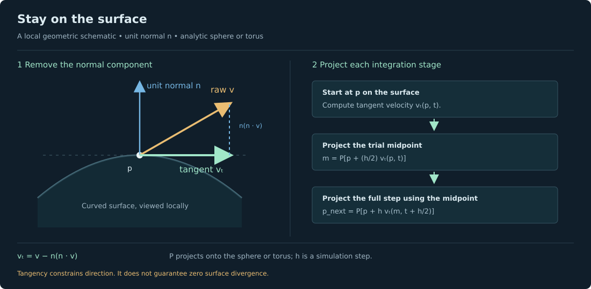
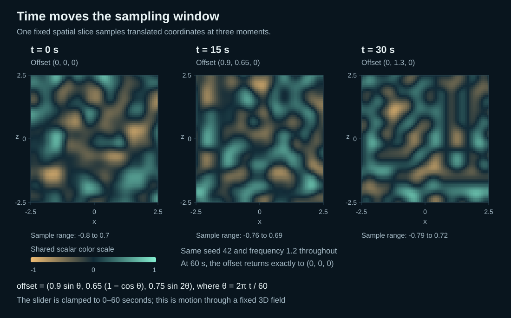

# Read the field: an illustrated Noise Lab guide

**Language: English · [日本語](NOISE_GUIDE.ja.md)**

[Project README and setup](../README.md) · [HTML edition](../public/docs/index.html)

One smooth function can become a landscape, a folded pattern, or a moving current. This guide explains what each Noise Lab experiment computes, what its controls change, and where the model stops. It can be read directly on GitHub, without running the interactive app.

The figures are controlled plots and original explanatory diagrams, not screenshots. The six sampled figures use the project's math; the surface-projection figure is a geometric schematic. Hold the seed, coordinates, time and color scale fixed when comparing panels. Each figure labels its sampling setup.

## Contents

1. [A map of the experiments](#a-map-of-the-experiments)
2. [Gradient noise, Billow and Ridged](#gradient-noise-billow-and-ridged)
3. [Frequency and amplitude](#frequency-and-amplitude)
4. [Building with octaves](#building-with-octaves)
5. [Domain warping and Wood](#domain-warping-and-wood)
6. [From values to vector fields](#from-values-to-vector-fields)
7. [Flow on a sphere or torus](#flow-on-a-sphere-or-torus)
8. [Moving through time](#moving-through-time)
9. [Controls and parameter recipes](#controls-and-parameter-recipes)
10. [Reproducing the diagrams and reading the source](#reproducing-the-diagrams-and-reading-the-source)
11. [Further reading](#further-reading)

## A map of the experiments

| Module | Main operation | What to look for |
| --- | --- | --- |
| **Noise** | A seeded gradient field produces one scalar value at each position; Billow and Ridged reshape that value | Smooth variation, folded zero crossings and ridges |
| **Octaves** | Several scales of the same base field are weighted and added | Broad forms with progressively finer detail |
| **Warp** | A three-component noise field changes the sampling coordinates; Wood adds a periodic radial pattern | Relocated, stretched and bent features |
| **Flow** | Spatial derivatives turn scalar or vector potentials into vectors that move particles | Direction, magnitude, trajectories and surface constraints |

These are related operations, not four unrelated random generators. Billow and Ridged are value transforms of the same base noise. Octaves compose scales; warp changes coordinates; Flow differentiates potentials.

This guide covers the implemented app. It does not include cellular/Voronoi noise, Simplex noise, libnoise's full RidgedMulti algorithm, or a physically simulated fluid.

Throughout the guide, `p = (x, y, z)` is a sampling position, `N` is the unscaled seeded base-noise function, and `f` is the visible frequency setting. Scalar mesh amplitude is a separate display multiplier.

## Gradient noise, Billow and Ridged

Imagine a repeatable landscape defined everywhere in space. Ask for a value at one point, then move a little: the answer changes smoothly. A seed chooses the arrangement; it does not add a new random value each frame.

The base function assigns a gradient direction to each integer lattice corner. Inside a cell, it blends the corner dot products with a smooth quintic curve. This is a seeded, Perlin-style gradient-noise implementation with twelve unit-length gradients and a seed-shuffled permutation. It repeats every 256 units along each **base-noise coordinate axis**.


**Figure 1. Same underlying samples, different output shapes.** Billow folds negative values upward; Ridged inverts the folded result. The figure uses seed 42, frequency 1.2, `y = 0.37` and time 0, with `x,z` in `[-2.5, 2.5]`. Its shared color scale makes the transformed values directly comparable.

### Exact Noise-module definitions

```text
n(p) = 1.55 N(f p)

Gradient(p) = n(p)
Billow(p)   = 2 |n(p)| − 0.7
Ridged(p)   = 0.7 − 2 |n(p)|
```

- **Gradient** is useful for smooth hills, texture variation and displacement. Positive and negative values vary continuously. Sampled values are not guaranteed to span exactly −1 to +1.
- **Billow** emphasizes rounded lobes separated by creases, useful for stylized cloud-like or rocky structure. The absolute value introduces a derivative kink where the original field crosses zero.
- **Ridged** turns those zero crossings into high ridges, useful for stylized mountain chains or veins. Here Ridged is exactly the negative of Billow. It is not a multi-octave, feedback-weighted ridged algorithm.

The transform names describe output shapes in this app. They do not imply that additional independent noise algorithms have been implemented.

**Try it:** In Noise, pause and reset time. Keep the seed fixed. Switch Gradient → Billow → Ridged without changing frequency or amplitude. The creases correspond to the original field's zero crossings.

### What makes the interpolation smooth?

For a fractional cell coordinate `u`, the fade polynomial is:

```text
fade(u) = 6u⁵ − 15u⁴ + 10u³
```

Its first and second derivatives vanish at both ends, helping interpolation join smoothly across cell boundaries. The twelve gradient directions are the permutations of `(±1, ±1, 0)`, divided by `√2`. This project uses its own seeded permutation and scaling, so it is not a bit-exact copy of another implementation.

Implementation: [`createNoise` and `createFields` in noise.js](../src/lib/noise.js).

## Frequency and amplitude

**Frequency changes feature size. Amplitude changes displacement height.** Frequency multiplies input coordinates before sampling. A larger value packs more variation into the same visible space. Amplitude scales geometric displacement after the scalar value has been computed; it does not change the scalar's pattern.


**Figure 2. Read spacing horizontally and scaled values vertically.** Both panels use seed 42 and the `y = z = 0` slice. The left compares frequencies 0.65 and 1.6 at amplitude 1; the right compares amplitudes 0.5 and 1.5 at frequency 0.9. Shape-specific rendering factors are omitted. Changing the seed would invalidate this controlled comparison.

**Color is field value, not displacement distance.** Increasing Amplitude moves vertices but does not change their sampled scalar values. Amplitude zero flattens the terrain, or restores the base sphere or torus, while the pattern can remain visible in color.

### Sampling positions and display scales

Before animation, the renderer maps base-geometry coordinates `(X, Y, Z)` to sampling coordinates as follows:

| Scalar shape | Sampling position before the animation offset | Geometric displacement |
| --- | --- | --- |
| Terrain | `(0.65X, 0.371, 0.65Z)` | Height = `1.65 × amplitude × value` |
| Sphere | `0.65(X, Y, Z)` | `0.50 × amplitude × value` along the base-surface normal |
| Torus | `0.65(X, Y, Z)` | `0.25 × amplitude × value` along the base-surface normal |

The animation offset is added to these sampling coordinates before evaluating the selected field. These shape-specific factors belong to the display, not the noise algorithm. The figures label their own sampling coordinates; their slices need not equal the renderer's terrain slice.

Very fine features can alias on a finite mesh. Fine quality adds samples, but cannot resolve unlimited frequency or octave detail. Small screens cap mesh resolution.

Implementation: [`animated-surface.js`](../src/lib/animated-surface.js).

## Building with octaves

Begin with broad hills. Add a weaker field with smaller features. Repeat. The result resembles a more detailed landscape while remaining deterministic. The app's fBm is a **finite weighted sum of gradient noise**, not an exact stochastic fractional Brownian process.


**Figure 3. The displayed contributions add to the final field.** Each contribution is evaluated at the same position with a different frequency and weight. This example uses four layers, base frequency 0.7, lacunarity 2 and gain 0.5. Each contribution is divided by the same weight sum, `1 + 0.5 + 0.25 + 0.125 = 1.875`. Compare the labelled scales rather than treating every panel as independently normalized.

### Normalized weighted sum

```text
                K−1
                Σ  gⁱ N(f λⁱ p)
                i=0
F(p) = ───────────────────────────
                      K−1
                      Σ  gⁱ
                      i=0
```

Equivalently, `F(p) = Σᵢ₌₀ᴷ⁻¹ gⁱ N(f λⁱ p) / Σᵢ₌₀ᴷ⁻¹ gⁱ`.

| Parameter | Meaning | Useful comparison |
| --- | --- | --- |
| **Layers K** | Number of terms included | One layer is just base noise at frequency `f` |
| **Lacunarity λ** | Frequency multiplier between layers | At 2, each layer has roughly half the feature size |
| **Gain g** | Amplitude-weight multiplier between layers | At 0.5, each new layer is half as strong; at 0, only the first contributes |

Strictly, an octave is a doubling of frequency; the app also allows other multipliers. The same base field is reused at each scale, without a new random generator for each layer.

Dividing by the sum of weights keeps the overall amplitude scale comparable. It does **not** guarantee constant variance, constant gradient magnitude or identical peak heights. Unlike the Noise tab, the Octaves tab uses the **unscaled base `N`, without Noise's 1.55 factor**.

**Try it:** Choose Octaves, pause, reset time and start at one layer. Increase to five with gain 0.5 and lacunarity 2. Then hold five layers and raise gain to 0.8. Fine detail becomes more influential. Use wireframe to notice when the mesh cannot resolve it.

This construction is useful for multiscale terrain and material variation. The finite, unfiltered sum is not a guarantee of natural erosion, scale invariance, or alias-free rendering.

Implementation: [`fbm` in noise.js](../src/lib/noise.js).

## Domain warping and Wood

Ordinary displacement changes output height. Domain warping changes the position used to ask for that output. A three-component noise field bends the coordinates first, so otherwise simple patterns stretch and curl.

```text
q = p + w W(p)

Warped terrain = fBm₄(q; frequency = f, lacunarity = 2, gain = 0.5)
```

Here `w` is Warp strength, `W` is the coordinate-offset field, and `q` is the distorted sampling position.


**Figure 4. Coordinate distortion, two final patterns.** Each pair compares warp strengths 0 and 1.6 using seed 42, frequency 0.8 and the same sample domain at time 0. Terrain and Wood share the coordinate distortion but evaluate different final scalar functions. The common scalar color scale is `[-0.65, 0.65]`.

Warp strength controls the coordinate offset. The warp channels themselves use **fixed frequency 0.65**, so the visible Frequency control changes the final pattern, not this internal warp frequency. The terrain branch **always uses four layers**, lacunarity 2 and gain 0.5. The Octaves tab's layer count is not applied here. At zero warp, terrain is the corresponding unwarped four-layer fBm.

### Exact warp-channel construction

With `N₀` seeded by `s`, `N₁` by `s + 1013`, and `N₂` by `s + 2029`:

```text
Wₓ(p) = N₀(0.65p + (17, 0, 0))
Wᵧ(p) = N₁(0.65p + (0, 31, 0))
W_z(p) = N₂(0.65p + (0, 0, 9))
```

These offsets and seed changes produce different channels; they are not claims of statistical independence.

### Wood starts with distance from an axis

Concentric rings arise from a sine wave of radial distance around the y-axis:

```text
r = √(qₓ² + q_z²)

Wood(p) = 0.65 sin[4π(f √(qₓ² + q_z²) + 0.25 N₀(f q))]
```

A small noise term modulates the rings' phase, and coordinate warp bends the rings. **Even at zero warp, Wood retains its small grain modulation.** Zero warp therefore does not produce a completely unperturbed radial sine field.

Wood is a stylized periodic pattern, not tree growth or a scanned wood texture. Warping is also not guaranteed to be invertible: strong distortion can fold space and create dense, hard-to-resolve details.

**Try it:** Choose Warp and set strength to zero. Raise it while keeping frequency fixed. Repeat with Wood rings. At a paused time, switch terrain → sphere → torus to see how one three-dimensional pattern intersects different shapes.

Implementation: [the Warp branch of `createFields.scalar`](../src/lib/noise.js).

## From values to vector fields

A scalar gives one value. A vector gives three components: a direction and a magnitude. Flow builds vectors from smooth noise potentials, then uses those vectors as particle velocities.


**Figure 5. A slice shows only two components of a three-dimensional vector.** The omitted y component still matters; a projected slice does not prove two-dimensional incompressibility. These plots use the app's finite-difference field functions directly, before cached interpolation, constant-speed normalization or surface projection. Arrow components have a shared linear scale; color shows full three-dimensional magnitude. The runtime app uses additional display scaling and caps, described below.

### Gradient: climb a scalar

```text
v = ∇a
```

The gradient points in the direction of steepest local increase. Its magnitude measures how rapidly `a` changes with distance. In a static gradient field, particles tend toward local maxima; animated potentials can move those maxima. A gradient field is not generally divergence-free.

### Curl: rotate a potential

```text
v = ∇ × A
```

A three-component potential `A` produces rotational structure. For a sufficiently smooth potential, the analytic divergence of its curl is zero. Individual paths need not be closed loops.

### Gradient cross: intersect level surfaces

```text
v = ∇a × ∇b
```

This vector is perpendicular to both scalar gradients. In a static analytic field, paths lie along intersections of level surfaces. Parallel or zero gradients give zero cross product.

For smooth `a` and `b`, the analytic gradient-cross construction is also divergence-free. That statement does not transfer unchanged to the app's approximations, normalized velocities, boundary resets, or surface projection.

### Exact potentials and curl signs

Using the same seeded functions `N₀`, `N₁`, `N₂` defined above:

```text
a(p) = N₀(f p + (2.1, 8.3, 4.7))
b(p) = N₁(f p + (5.1, 1.3, 9.7))
c(p) = N₂(f p + (7.1, 3.3, 1.7))

A = (a, b, c)

∇ × A = (∂c/∂y − ∂b/∂z,
         ∂a/∂z − ∂c/∂x,
         ∂b/∂x − ∂a/∂y)
```

Derivatives are with respect to world-sampling coordinates, so changing frequency also changes derivative magnitudes. The field is a procedural velocity model, not a solver of pressure, viscosity or conservation laws.

### What the visualization actually does

1. **Approximate derivatives.** Centered differences use step `h = 0.005` for gradients and `h = 0.008` for curl. For example, `∂a/∂x ≈ [a(x+h,y,z) − a(x−h,y,z)] / (2h)`.
2. **Cache the ambient field.** A padded grid over ±4.65 is sampled when the field is built, then trilinearly interpolated for subsequent lookups. Resolution is 33³, or 41³ when frequency exceeds 1. Animation translates lookup coordinates within this cache. Rare integration probes outside the safe cache region use direct field evaluation. High-frequency derivative detail can be smoothed or under-resolved.
3. **Apply surface projection when needed.** On a sphere or torus, the sampled ambient vector is projected onto the tangent plane at the current surface point. In Volume, no tangent projection is applied.
4. **Apply particle speed settings.** Flow speed multiplies the resulting vector. Constant-speed mode first normalizes it, subject to a small-magnitude threshold. Arrows and magnitude colors use the raw field before these particle-speed operations.
5. **Integrate motion.** Particles use midpoint/RK2 at `1/60` simulated second, including a time-midpoint sample when the field evolves. At most five catch-up steps are taken per render. Under load, the simulated clock may run slowly instead of taking unstable large steps.

Here **raw** means before Flow speed and constant-speed normalization. In the running app, raw values can already include cache interpolation and, on surfaces, tangent projection. Raw does not mean an exact analytic derivative.

### Raw magnitude versus constant-speed particles

If `v_raw` is the cached/interpolated field after any tangent projection and `s` is Flow speed, particle velocity is:

```text
Constant speed off:  velocity = s v_raw

Constant speed on:   velocity = s v_raw / |v_raw|   if |v_raw| > 10⁻⁸
                     velocity = 0                  otherwise
```

Constant speed changes the field. Small nonzero vectors above the threshold no longer move slowly, stagnation points remain stationary, and the resulting velocity is generally not divergence-free.

### Reading arrows, colors and trails

- **Arrows** describe the raw field, or raw tangential field on surfaces, before Flow speed or constant-speed normalization. Their lengths are visually scaled and capped; they are not exact velocity rulers.
- **Magnitude color** is relative to the maximum at arrow sample positions. A particle can exceed that maximum and saturate the color scale. Adjusting arrow density can change that sampled maximum without changing the underlying field.
- **Trails** show recent particle history, not a complete instantaneous streamline. In a time-varying field, they are pathlines.
- **Volume particles** respawn when they leave the display volume or reach their lifetime. Boundary resets do not represent a conservation-preserving physical boundary condition.
- **Density and trail controls** change display sampling or stored history. They do not add physical accuracy.

**Try it:** Select Flow → Volume. Compare Gradient, Curl and Gradient cross with the same seed and frequency. Pause to inspect arrows; resume to see paths. Increase arrow density for spatial sampling and trail length for more history. Then compare raw-speed and constant-speed motion while watching the unchanged meaning of the magnitude colors.

Implementation: [derivatives, field construction, cache interpolation and RK2](../src/lib/noise.js), [runtime flow and rendering](../src/lib/scene.js), and [cache dimensions](../src/lib/animation.js).

## Flow on a sphere or torus

In Flow, choose Sphere or Torus to keep particles on a smooth, undeformed surface. At a point `p` with unit normal `n`, remove the component of the ambient vector that points through the surface:

```text
vₜ = v − n(n · v)

n · vₜ = 0
```



**Figure 6. Tangency and positional constraint are separate steps.** This is a local geometric schematic, not a rendered simulation. Removing normal velocity gives a tangent direction; projecting both integration stages prevents numerical drift off the analytic surface.

The sphere has radius **2.45**. The torus wraps around the y-axis with major radius **2** and tube radius **0.75**. Integration stores Cartesian coordinates, avoiding longitude seams and latitude-pole charts.

A constrained midpoint step starts from a point projected onto the surface, evaluates tangent velocity there, projects its trial midpoint back onto the surface, evaluates tangent velocity at that midpoint, and projects the final point back onto the surface. For an evolving field, the second evaluation uses the midpoint in time as well as space.

**Projection changes divergence.** An ambient divergence-free curl can have nonzero surface divergence after tangent projection. Cached interpolation and constant-speed normalization add further changes. The lab therefore makes **no incompressibility claim** for curved-surface flows.

Simulation positions satisfy the analytic surface constraint to floating-point tolerance. Points and trails are rendered **0.018 units** above it, and arrows **0.026 units** above it, to avoid depth overlap. Straight trail segments approximate a curved path; the displayed line is not itself a continuous geodesic or exact trajectory.

Changing geometry or field resets paths. Sphere and torus particles do not respawn on a lifetime timer. Initial sphere particles are sampled uniformly by surface area; torus particles use rejection sampling to account for the surface-area Jacobian.

**Try it:** Choose Curl → Sphere, then Torus. Pause, orbit and inspect arrows near different normals. Resume and watch trails follow the surface. Increase Flow speed to travel farther per simulated second; use Playback speed to change the entire simulated clock.

Scalar sphere/torus displacement in Noise, Octaves and Warp is a separate visualization. Surface Flow uses fixed, smooth geometry; it does not advect particles over those displaced meshes.

Implementation: [`surface.js`](../src/lib/surface.js) and [Flow rendering in scene.js](../src/lib/scene.js).

## Moving through time

Time moves sampling coordinates through the existing **three-dimensional field**. It does not add a fourth noise dimension. The bounded translation starts at zero, moves smoothly, and returns to zero at 60 seconds:

```text
Fₜ(p) = F(p + d(t))

θ = 2πt / 60

d(t) = (0.9 sin θ, 0.65(1 − cos θ), 0.75 sin 2θ)
```

The timeline clamps `t` to `[0, 60]`; the implementation returns exactly `(0, 0, 0)` at both endpoints.



**Figure 7. Same field, moving sample coordinates.** Seed and parameters stay fixed while sample offsets change. At 0 and 60 seconds, the scalar field is identical. This does not imply that moving particles return to their starting positions, or that playback loops automatically.

### Each module keeps its actual function

- **Noise** animates the selected Gradient, Billow or Ridged transform.
- **Octaves** animates the complete weighted sum, keeping its layer count, gain and lacunarity.
- **Warp** animates the full warped terrain or Wood function, including its coordinate distortion.
- **Flow** translates the ambient field. On a surface, it then projects with the normal at the current, **unshifted surface point**, at each integration stage. It does not use the normal at the translated lookup point.

For Flow, this distinction is expressed by:

```text
lookup point = p + d(t)
ambient vector = cached ambient field at the lookup point
surface tangent vector = ambient vector − n(p)[n(p) · ambient vector]
```

### Playback, scrubbing and repeatability

| Action | Result |
| --- | --- |
| **Pause** | Stops the relevant simulation and automatic camera rotation; manual orbit and zoom remain available |
| **Scrub time** | Pauses playback and updates the selected field time |
| **Reset time** | Pauses playback and returns time to zero |
| **Scrub Flow** | Restarts seeded particles and trails at the chosen field time; does not replay preceding history |
| **Restart particles** | Clears paths and restarts seeded particles at the current field time |
| **Switch modules** | Resets time to zero while retaining the playing/paused choice |
| **Reach 60 seconds** | Stops playback; Play at the endpoint restarts from zero |
| **Change scalar shape** | Retains the selected time |

Scalar geometry is determined only by seed, settings and time, independently of playback history. Particle trajectories also depend on their integration history. Restarting and repeating the same sequence of steps and settings is deterministic; wall-clock playback can depend on rendering performance.

Flow speed scales particle velocity. Playback speed controls the simulated clock, including field evolution and particle integration. Neither control increases numerical accuracy.

When the field changes with time, particle trails are pathlines through an evolving field. The static gradient-cross level-surface interpretation does not generally persist as time evolves.

Implementation: [`animation.js`](../src/lib/animation.js), [timeline controls](../src/components/Timeline.jsx), and [simulation clock in scene.js](../src/lib/scene.js).

## Controls and parameter recipes

### Compact control reference

| Control | Changes | Does not mean |
| --- | --- | --- |
| Seed | The repeatable arrangement | Animation time or feature scale |
| Frequency | Spatial input scale; Flow derivative magnitudes also change | Octave count |
| Amplitude | Scalar mesh displacement | Different scalar color values |
| Layers / Gain / Lacunarity | Number, weight and frequency ratio of fBm terms | Fixed variance or extra mesh resolution |
| Warp strength | Coordinate distortion before the final sample | Only taller terrain |
| Flow speed | Particle velocity multiplier | Faster evolution of the field itself |
| Constant-speed particles | Normalizes non-negligible particle vectors before applying Flow speed | Preservation of divergence or magnitude differences |
| Playback speed | Simulated clock rate, including field evolution | Higher numerical accuracy |
| Arrow density / length | Display sampling and glyph scale | A change to the underlying field |
| Trail length | Stored recent path samples | An instantaneous streamline |
| Render quality | Scalar mesh resolution, capped on small screens | Removal of all aliasing |

### Three short experiments

For comparisons, pause and reset to time 0, keep seed 42 and leave unmentioned settings fixed. Resume only when observing particle motion or animation.

| Experiment | Settings and procedure | What to inspect |
| --- | --- | --- |
| **Find the ridges** | Noise; frequency 1.2; compare Gradient → Billow → Ridged | The shared zero-crossing structure; Ridged and Billow have opposite values |
| **Separate detail from distortion** | Octaves: five layers, gain 0.5, lacunarity 2. Compare with fewer layers. Then Warp: strength 0 versus 1.5 at fixed frequency | Layering adds scales; warping relocates features. The Warp terrain branch remains fixed at four layers |
| **Separate direction from transport** | Flow; Curl; frequency 0.65. Compare constant speed off/on, then Volume → Sphere → Torus | Magnitude colors describe raw vectors while normalized particles change speed; surface projection changes the field |

### Focused parameter recipes

| Question | Recipe | Expected reading |
| --- | --- | --- |
| What does amplitude do by itself? | Noise, Gradient, fixed seed/frequency/time; lower Amplitude to 0 | Geometry returns to its base shape while scalar color variation can remain |
| What does gain add? | Octaves, five layers, lacunarity 2; compare gain 0, 0.5 and 0.8 | At 0 only the first layer contributes; larger gain gives finer layers more influence |
| Is Wood at zero warp a pure sine pattern? | Warp → Wood rings; strength 0; then gradually increase strength | A small phase-grain modulation already exists at zero; additional warp bends coordinates |
| Does returning to the initial field return particles? | Flow; run the 0–60-second timeline | The ambient field returns to its initial offset; accumulated particle displacement need not vanish |

Control ranges and labels are defined in [`Controls.jsx`](../src/components/Controls.jsx). Starting settings and module presets are in [`lessons.js`](../src/lib/lessons.js).

## Reproducing the diagrams and reading the source

From the project root, after installing dependencies as described in the [README](../README.md):

```sh
npm run docs:figures
npm run check
```

The first command regenerates the six sampled SVG figures using the current math modules, then produces all seven Japanese-localized figures without changing the sampled data. The seventh figure, the surface-projection schematic, is authored separately. The localizer verifies unchanged drawing geometry, numerical values and mathematical expressions; unexpected English-label changes require translation review. The second command runs the project's lint checks, tests and production build, including the documentation checks present in the checkout.

The figures use fixed seeds and labelled coordinates. They do not depend on generated imagery, browser screenshots, a hosted Site, or a remote application service.

| Source | What it contains |
| --- | --- |
| [`scripts/generate-doc-figures.mjs`](../scripts/generate-doc-figures.mjs) | Reproducible sampling and SVG generation for six figures |
| [`public/docs/images/figure-manifest.json`](../public/docs/images/figure-manifest.json) | Figure parameters, measured ranges and sampling metadata |
| [`public/docs/images/surface-projection.svg`](../public/docs/images/surface-projection.svg) | Original geometric surface schematic |
| [`src/lib/noise.js`](../src/lib/noise.js) | Seeded base noise, transforms, fBm, derivatives, vector fields, RK2 and cache interpolation |
| [`src/lib/animation.js`](../src/lib/animation.js) | Bounded time arithmetic, translated sampling and flow-cache settings |
| [`src/lib/surface.js`](../src/lib/surface.js) | Surface projection, normals, tangent vectors, constrained integration and sampling |
| [`src/lib/animated-surface.js`](../src/lib/animated-surface.js) | Scalar sampling coordinates and mesh-displacement scales |
| [`src/lib/scene.js`](../src/lib/scene.js) | Runtime arrows, colors, particles, clock and rendering behavior |
| [`tests/noise.test.js`](../tests/noise.test.js) | Deterministic, numerical, continuity and identity checks |
| [`tests/surface.test.js`](../tests/surface.test.js) | Surface constraints, tangency, singular inputs, convergence and replay checks |
| [`tests/integrated-animation.test.js`](../tests/integrated-animation.test.js) | Module animation, bounded cache shifts, time-varying fields and temporal RK2 checks |
| [`tests/docs.test.js`](../tests/docs.test.js) | Documentation structure, assets and figure-regeneration checks |

## Further reading

- [Ken Perlin, *Improving Noise*](https://mrl.cs.nyu.edu/~perlin/paper445.pdf)
- [*Physically Based Rendering*, chapter on Noise](https://www.pbr-book.org/3ed-2018/Texture/Noise)
- [Bridson, Hourihan and Nordenstam, *Curl-Noise for Procedural Fluid Flow*](https://www.cs.ubc.ca/~rbridson/docs/bridson-siggraph2007-curlnoise.pdf)

These references explain underlying ideas. Exact constants and behavior in this guide refer to this project's independent educational implementation; they do not assert that the project reproduces those implementations. No libnoise source is included.

Project source is [MIT-licensed](../LICENSE). Third-party packages retain their own licenses; see [Third-party notices](../THIRD_PARTY_NOTICES.md).

[Back to top](#read-the-field-an-illustrated-noise-lab-guide) · [Return to the README](../README.md)
